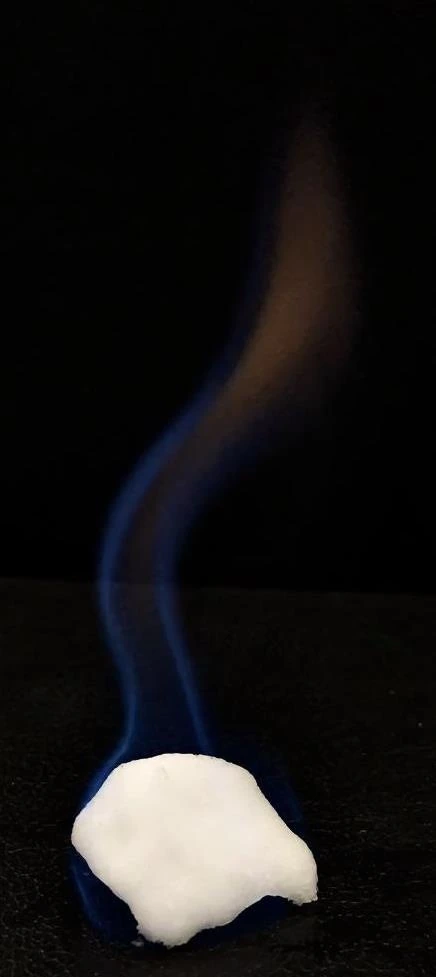
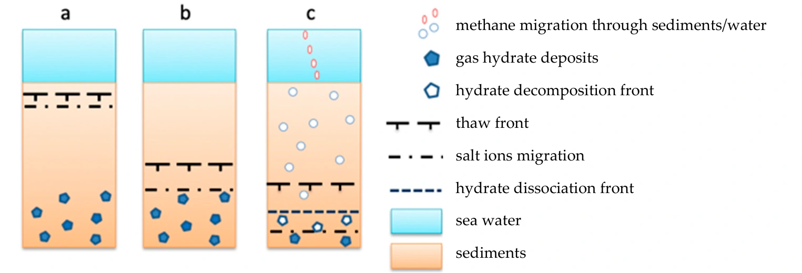

# Gas Hydrates & Frozen Sediments

**Valentina Ekimova, PhD — experimental geocryology**

[Website research page](hydrates.html) · [Undergraduate seminar: Frozen Fire](frozen-fire.html) · [Current Arctic research](research.html) · [Academic CV](cv.html)

## Burning methane hydrate — demonstration photograph

*Photograph: Dinara Davletshina. Associated demonstration video: Ekaterina Krivokhat (not reproduced). Extracted from the undergraduate seminar presentation "Frozen Fire", slide 2.*

## Published salt-migration model

*Figure 11: estimated model of seawater salt migration into subsea permafrost and possible hydrate destabilization, from Chuvilin, Ekimova et al. (2019), [Geosciences 9(4), 188](https://doi.org/10.3390/geosciences9040188). CC BY 4.0. The diagram and legend are cropped from the original uploaded PDF, and the model is not presented as direct field evidence.*

## PhD defense (2022)

I defended my PhD in Petroleum Engineering at Skoltech on October 19, 2022. My dissertation, *Experimental Modeling of Gas Hydrates Interaction with a Salt Solution in Permafrost*, examined how saline solutions interact with hydrate-bearing frozen sediments under different temperature, pressure and sediment conditions. Dr. Evgeny Chuvilin supervised the research.

- [Official Skoltech PhD defense record](https://www.skoltech.ru/en/applicants/valentina-ekimova)
- [Read the full dissertation](https://back.skoltech.ru/storage/app/media/defenses/2022/valentina-ekimova/theme/thesis1.pdf)

## The research question

How do saline fluids, pressure, temperature, and sediment composition control ice and methane-hydrate stability in frozen ground?

My doctoral work at Skoltech focused on experimental modeling of interactions between gas hydrates and salt solutions in permafrost. This laboratory program was developed with Evgeny Chuvilin and colleagues at MSU and Skoltech.

## Findings from published work

- **Salt migration and phase transitions:** dissolved ions can migrate through hydrate-bearing frozen sediments, induce pore-ice melting, and destabilize metastable methane hydrates at subzero temperatures.
- **Different fronts:** the methane-hydrate dissociation front may advance ahead of the pore-ice melting front in laboratory samples.
- **Controlling factors:** pressure, temperature, solution chemistry and concentration, and sediment texture affect ion transport and hydrate stability.
- **Engineering relevance:** subsequent experiments investigated natural cryopegs and interactions with drilling fluids.
- **Limits of inference:** laboratory-observed dissociation does not by itself establish regional field methane fluxes.

The 2019 Geosciences paper's author-contribution statement specifically documents my role in experimental methodology, calculations, experimental work, analysis, and writing alongside coauthors.

## Selected papers (English and Russian)

- **2026:** Chuvilin, Krivokhat, Bukhanov, Sokolova, Ekimova, and Mukhametdinova. *Experimental modeling of the interaction of drilling fluids with frozen hydrate-containing rocks* / «Экспериментальное моделирование взаимодействия буровых растворов с мерзлыми гидратосодержащими породами». [DOI](https://doi.org/10.15372/KZ20260204)

  **Short summary:** Experiments evaluated how drilling-fluid temperature and composition affect frozen hydrate-bearing sand. Saline cryopeg contamination accelerated ion transfer and pore-hydrate dissociation, highlighting an engineering concern for wells in Arctic permafrost.
- **2025:** Chuvilin et al. *Destabilization of intrapermafrost gas hydrates by salt migration from cryopegs: experimental results* / «Дестабилизация внутримерзлотных газогидратов при их взаимодействии с криопэгами». [DOI](https://doi.org/10.18599/grs.2025.3.6)

  **Short summary:** Laboratory tests with natural-style saline brines examined how dissolved salt from cryopegs and seawater may destabilize intrapermafrost hydrates. The study identifies a mechanism, not a field-scale methane emission rate.
- **2023:** Chuvilin, Ekimova, Davletshina, Bukhanov, and Krivokhat. *Salt transfer in frozen methane hydrate-containing sediments during their interaction with salt solutions* / «Солеперенос в мерзлых породах, содержащих гидрат метана, при их взаимодействии с солевыми растворами». [DOI](https://doi.org/10.15372/KZ20230604)

  **Short summary:** Experiments found more intensive salt penetration in hydrate-bearing than hydrate-free frozen sand. Higher gas pressure and colder temperatures slowed migration, allowing quantitative estimates of salt flux and diffusion.
- **2023:** Chuvilin et al. *Migration of Salt Ions in Frozen Hydrate-Saturated Sand: Effect of Silt and Clay Particles*. [DOI](https://doi.org/10.1021/acs.energyfuels.3c00274)

  **Short summary:** Changing the proportions and mineralogy of silt and clay showed how fine particles control ion and water migration in hydrate-saturated sand. More clay generally limited salt penetration and affected hydrate dissociation thresholds.
- **2022:** Chuvilin et al. *Pressure Influence on Salt Migration in Frozen Hydrate-Saturated Sediments: Experimental Modeling*. *Energy & Fuels* **36**(18), 10519–10528. [DOI](https://doi.org/10.1021/acs.energyfuels.2c01282)

  **Short summary:** At approximately −6°C, tests at 0.1–4.0 MPa showed that gas pressure substantially affects Na⁺ transport. Lower pressures accelerated salt migration and destabilization of pore methane hydrates.
- **2022:** Chuvilin et al. *Migration of Salt Ions in Frozen Hydrate-Saturated Sediments: Temperature and Chemistry Constraints*. [DOI](https://doi.org/10.3390/geosciences12070276)

  **Short summary:** Experiments compared solutions with different ion compositions and concentrations to test how temperature and chemistry influence salt transport and hydrate stability. Brines with the same general salinity need not produce the same response.
- **2022:** Chuvilin et al. *Temperature Variation during Salt Migration in Frozen Hydrate-Bearing Sediments: Experimental Modeling*. [DOI](https://doi.org/10.3390/geosciences12070261)

  **Short summary:** NaCl migration into frozen hydrate-bearing sediment produced heat-consuming ice melting and hydrate dissociation at about −6°C. The samples cooled faster and returned more slowly to their initial temperature than hydrate-free controls.
- **2020:** Chuvilin et al. *Evidence of Gas Emissions from Permafrost in the Russian Arctic*. [DOI](https://doi.org/10.3390/geosciences10100383)

  **Short summary:** A synthesis of gas-emission evidence from Russian Arctic onshore and offshore permafrost considers lakes, craters and drilling sites. It discusses several possible sources rather than attributing all reported emissions to gas hydrates.
- **2019:** Chuvilin et al. *Role of Warming in Destabilization of Intrapermafrost Gas Hydrates in the Arctic Shelf: Experimental Modeling*. [DOI](https://doi.org/10.3390/geosciences9100407)

  **Short summary:** Controlled warming of sands and silts containing metastable methane hydrates examined how rising temperatures can trigger dissociation. These laboratory observations describe a potential process during permafrost degradation, not measured regional methane fluxes.
- **2019:** Chuvilin et al. *Role of Salt Migration in Destabilization of Intra Permafrost Hydrates in the Arctic Shelf: Experimental Modeling*. [DOI](https://doi.org/10.3390/geosciences9040188)

  **Short summary:** Frozen methane-hydrate-bearing sands were exposed to cooled NaCl solutions. Salt penetration promoted pore-ice melting and methane release, with hydrate dissociation advancing ahead of the thawing front under the tested conditions.

This is a selected research bibliography, not a complete publications list. Research outcomes and coauthor contributions are documented in the linked publications. The full web page also includes a conceptual schematic of saline fluid interaction with frozen hydrate-bearing sediments.
