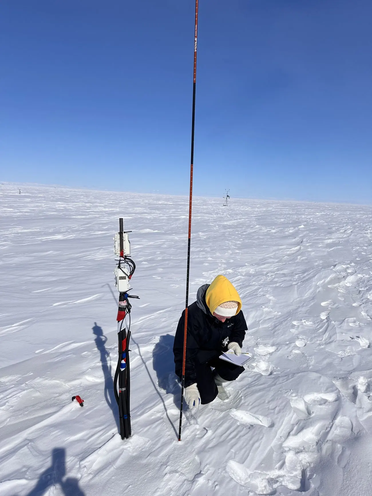
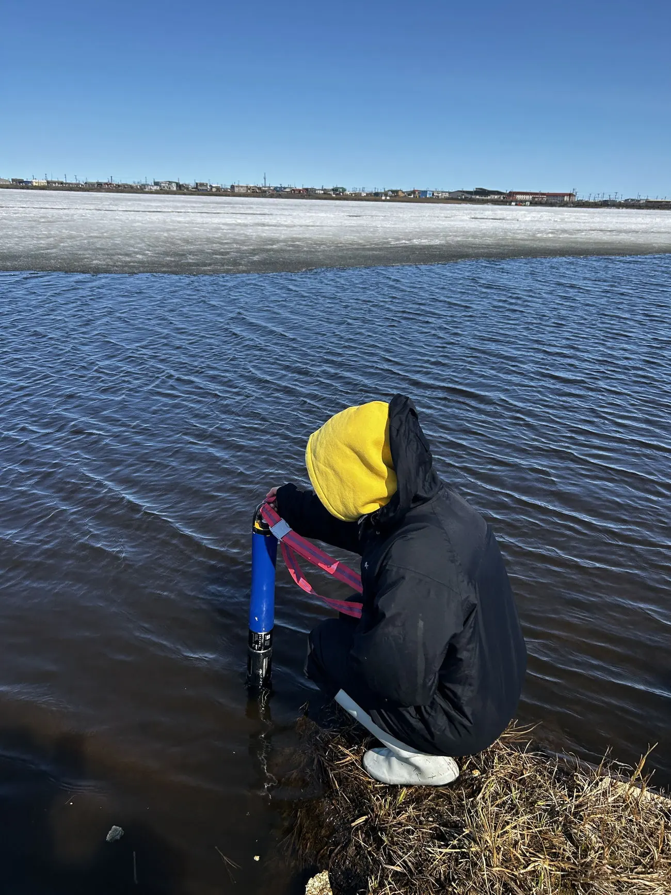
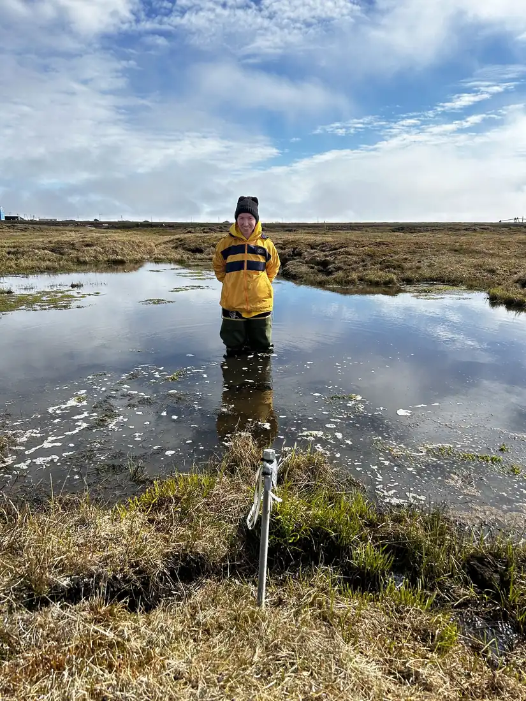
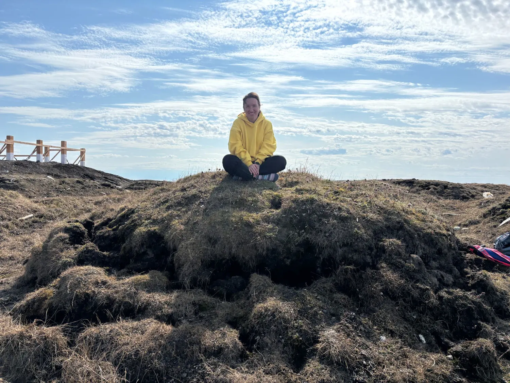
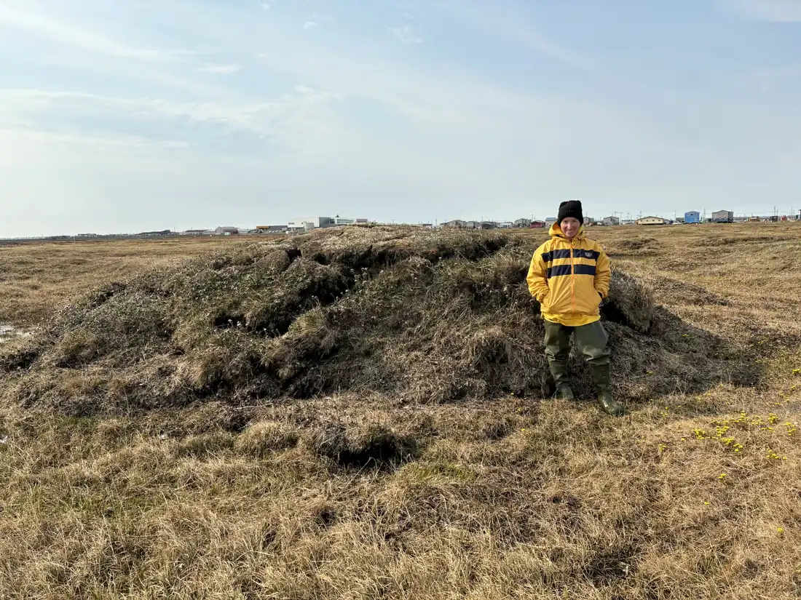
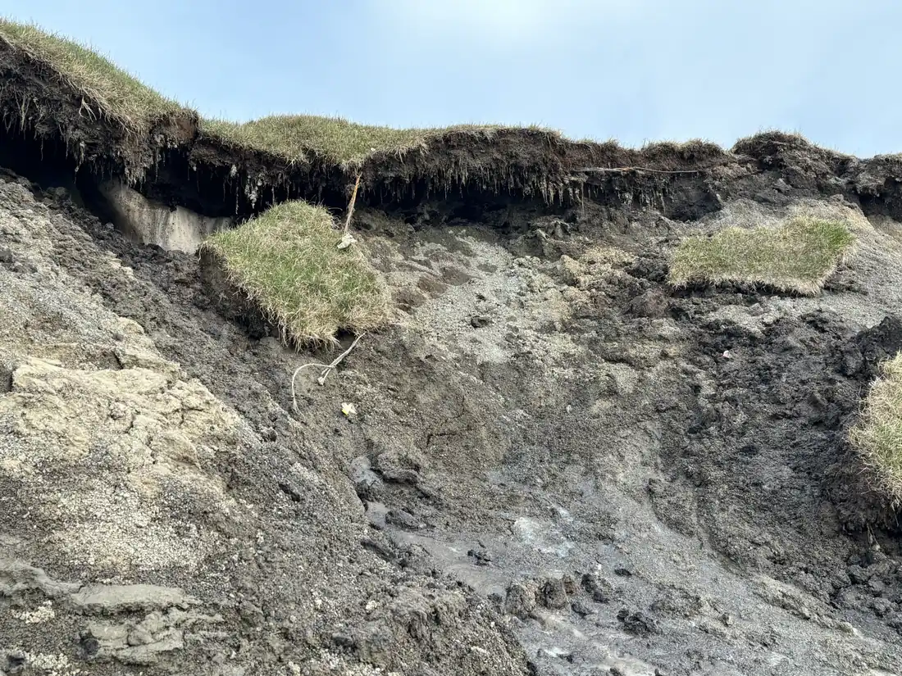
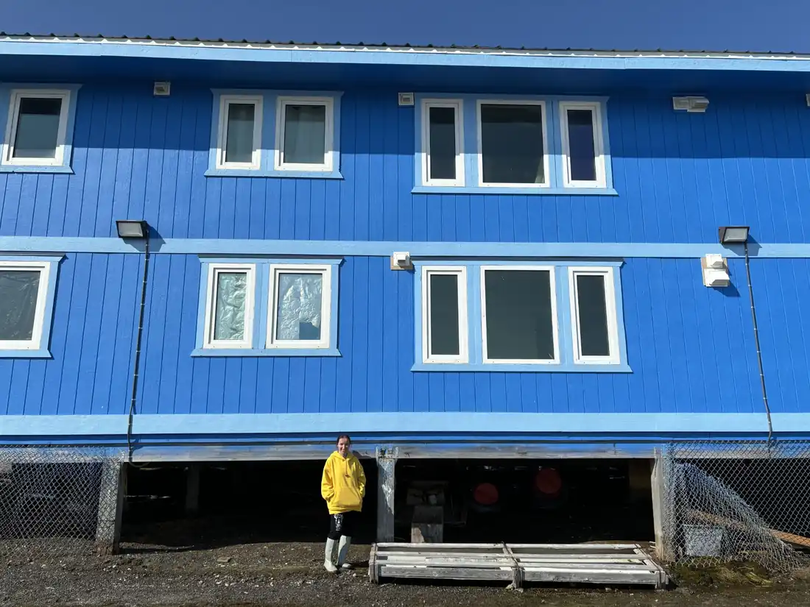
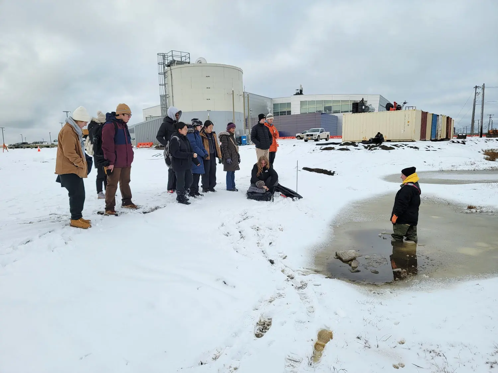
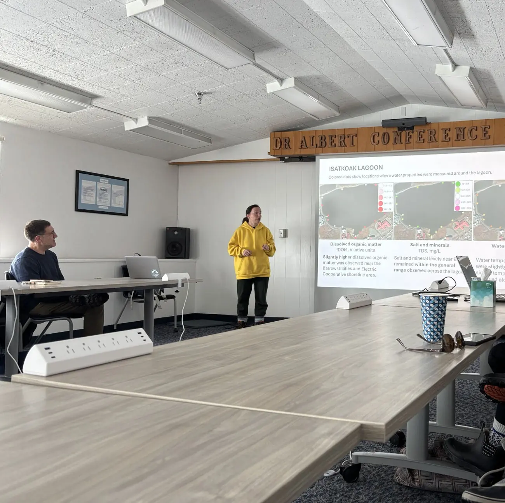

# Arctic field photographs

Photographs from Valentina Ekimova's research and field activities in Utqiaġvik, Alaska. This gallery can be viewed directly on GitHub without deploying the website.

## Fieldwork and environmental observations

### Winter snow measurements

Winter field monitoring and snow observations in Arctic tundra.

### Lagoon measurements

Measuring water-quality characteristics at Isatkoak Lagoon with an EXO multiparameter sonde.

### Arctic wetlands

Field observations in shallow surface water near Utqiaġvik.

## Permafrost landscapes

### Frost-heave landform

Portrait on a frost-heave feature in the Arctic tundra.

### Frost heave at landscape scale

Examining frost-heave morphology in the Arctic landscape.

### Exposed frozen ground

Ground exposure illustrating surface erosion and frozen-ground processes.

## Infrastructure and community

### Elevated Arctic building

Infrastructure elevated above the ground in Utqiaġvik.

### Teaching in the field

Field instruction on snow, water, and the built Arctic environment.

### Sharing water-quality findings

Presenting Isatkoak Lagoon research findings to Barrow Utilities and Electric Cooperative (BUECI) in 2026.

---

[Explore the website source](index.html) · [Academic CV](cv.html)

To experience the website's actual design and navigation, open the full website using a local browser or a private GitHub Codespaces preview. GitHub's Markdown viewer is a photo gallery, not a renderer for the HTML site.
